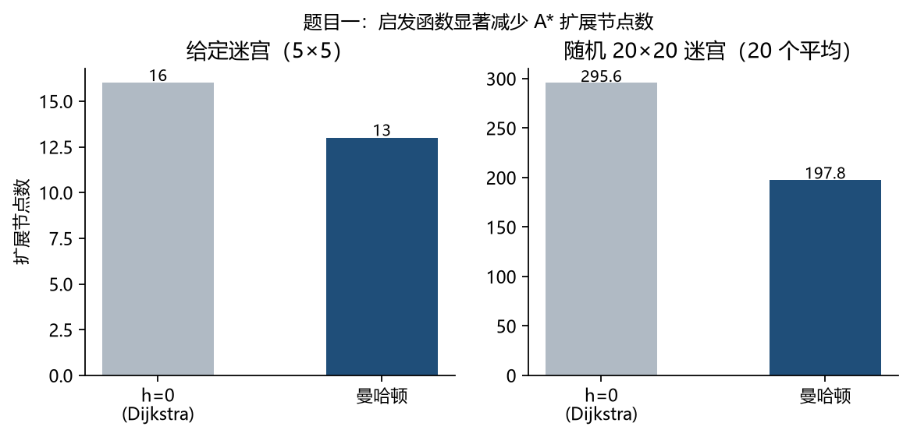
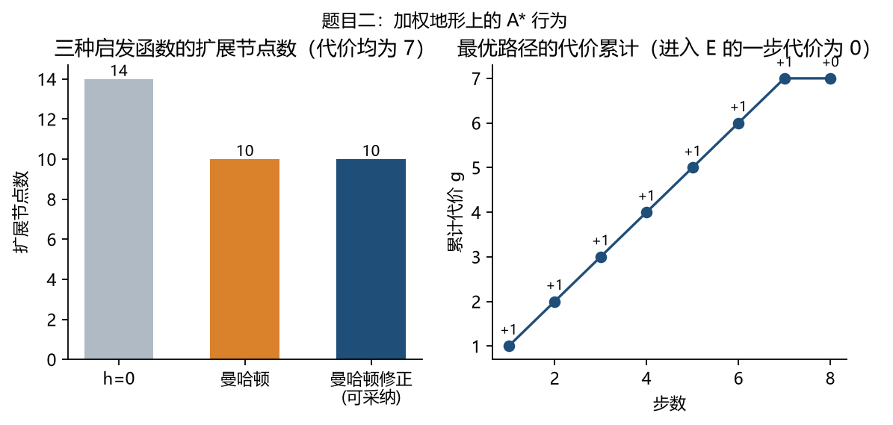
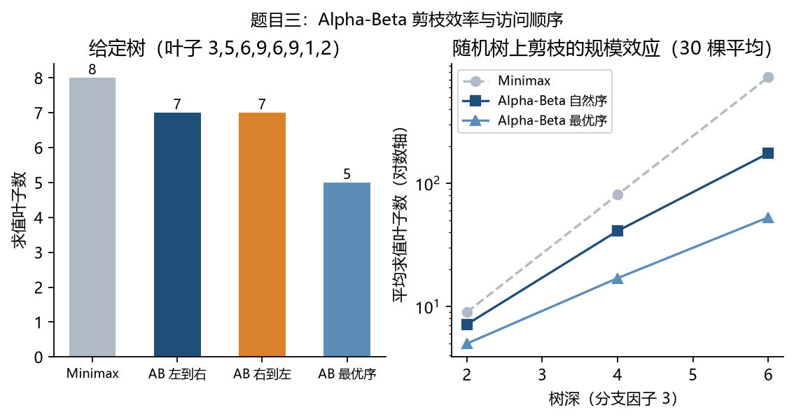
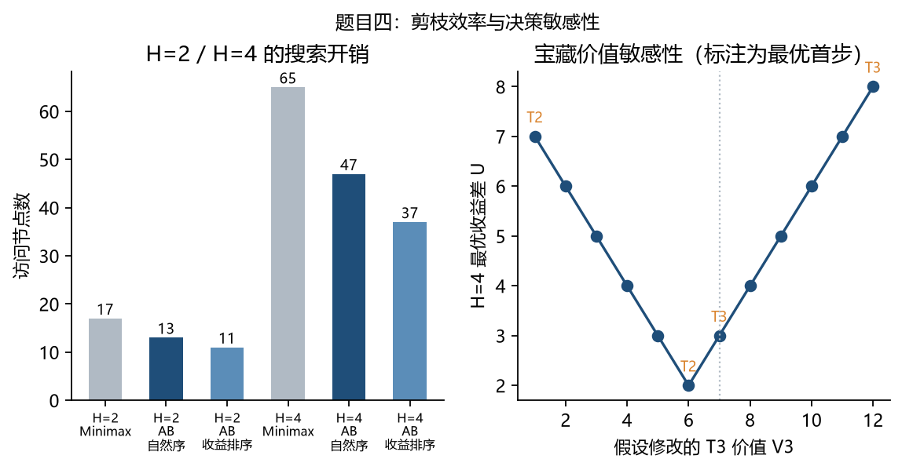

# 实验二 搜索算法 实验报告

代码仓库：https://github.com/TinjiYDon/ai-exp2-search-algorithms

代码、README 与本文用到的全部实验数据都在上面的仓库里。python run_tests.py 复现四个给定用例，python run_experiments.py 复现文中数据。

## 一、实现与实验设置

A*、Minimax、Alpha-Beta 各写了一份，四道题共用。环境是 Python 3.12，算法部分只用标准库，画图和生成本报告另外用到了 matplotlib 和 fpdf2。

A* 的状态是网格坐标。四道题的区别只在于能不能走、进入一格花多少代价、启发函数怎么算，这三件事都从外面传进去，搜索本身只做一件事：把 f=g+h 最小的节点从堆里取出来扩展。为了结果可复现，堆里除 f 之外还压了一个自增序号，f 相同时先入堆的先出，这样每次运行的扩展顺序都一样。closed 表记下每个状态目前最好的 g，从堆里弹出的过期副本直接跳过。搜索过程统计扩展节点数和 OPEN 峰值，后面对比启发函数用的就是这两个数。

Minimax 和 Alpha-Beta 的逻辑比较简单：叶子回传数值，MAX 层取大、MIN 层取小。Alpha-Beta 多带 alpha 和 beta 两个参数，分别表示当前路径上 MAX 已经能保证的下界和 MIN 能保证的上界，某一层的值越出这个区间，剩下的兄弟节点就不用再算，因为父节点不会选它。剪枝不应该改变根节点的返回值，所以我把“两种算法输出相同”当成正确性检查，用访问节点数衡量剪掉了多少。

综合题的状态记成（A 位置、B 位置、剩余宝藏、双方累计分、轮到谁）。一次转移就是当前玩家挑一颗宝藏，用事先算好的距离得出这一手的 Gain 并累加。

## 二、题目一：迷宫寻路

给定迷宫从 (0,0) 到 (3,4)，程序返回 8 个坐标的路径，终点被障碍围死时返回空列表，两种情况都放进了 run_tests.py。

这条路径的形成有点巧：起点到终点的曼哈顿距离正好是 7，最优路径也正好 7 步，于是最优路径上每个节点都满足 g+h=7。f 恒等于 7，堆顶永远是这条路上的下一个点，搜索几乎直线走到终点；(1,0) 这种偏离目标的点 f=1+8=9，一直沉在堆底，直到终点被取出都没轮到扩展。

把 h 换掉之后差别更明显。给定迷宫上 h=0 扩展了 16 个节点，曼哈顿扩展 13 个，路径长度都是 8。放大到 20 个 20×20 的随机迷宫（障碍率 0.25，固定种子，只留有解的地图），h=0 平均扩展 295.6 个，曼哈顿 197.8 个，少了约三分之一。h=0 时 A* 退化成 Dijkstra，从起点一圈一圈往外铺，不管终点在哪边；曼哈顿给出了方向，搜索区域被压到朝向终点的那一侧，启发越接近真实剩余代价，压掉的区域越多。两种启发找到的路径一样长，因为每步代价为 1 时曼哈顿不会高估。

| 启发函数 | 给定迷宫：扩展/生成 | 20×20 随机图：平均扩展 | 路径长度 |
|---|---|---|---|
| h=0（Dijkstra） | 16 / 18 | 295.6 | 8 |
| 曼哈顿距离 | 13 / 16 | 197.8 | 8 |

## 三、题目二：加权地形

这题把“最短”换成了“最便宜”。程序返回的路径与题目给定的一致：(0,0)→(1,0)→(2,0)→(3,0)→(3,1)→(3,2)→(4,2)→(4,3)→(4,4)，总代价 7。前七步各花 1，最后一步进入 E 按规则不收费，所以累计 g 是 1、2、3、4、5、6、7、7。地图里没有障碍，拦住路线的是 8：它们集中在左侧第 1 列和中间第 3 列，直着穿过去一步就要多花 8，贴着左边缘再走第 4 行反而便宜。

这里有个我一开始写错的地方。因为最小地形权值是 1，我直接把曼哈顿距离当 h，觉得每步至少花 1，肯定不高估。后来按“进入 E 代价为 0”的规则构造了一个 [[S,E]] 的小例子：S 与 E 相邻时真实剩余代价是 0，而 h(S)=1，已经高估了。在这一题里高估最多只有 1，没有改变扩展顺序——h=0、曼哈顿、修正版返回的代价都是 7，扩展节点数分别是 14/10/10——但严格说前两个 h 并不可采纳，最优性没有保证。改成 h=max(曼哈顿-1, 0) 之后就不会高估：任意 L 步路径至少花 (L-1)×1，最后一步免费。

这条路径是被代价推出来的，不是被墙逼出来的。把地图里所有 8 都改成 1，从左上到右下会冒出很多条等长的路线；8 的存在让“绕远但便宜”压过了“走近但贵”。这也是加权地图和普通迷宫的区别：A* 比的是累计代价，不是步数，所以同样长度甚至更长的路径也可能更优。

## 四、题目三：Alpha-Beta 剪枝

给定树从叶子往回算：三个 MAX 节点分别得到 5、9、2，两个 MIN 节点取 min(5,9)=5、min(9,2)=2，根取 max(5,2)=5，和预期输出一致。

剪枝发生在右边那棵 MIN 子树里。左边先算完，根节点的 alpha 变成 5；进入右子树，第一个 MAX 孩子 {6,9} 回传 9，这时还不能确定右子树的值；第二个 MAX 孩子先看到叶子 1，右子树的值不可能超过 1，已经小于 alpha=5，根不会选它，于是这个孩子的另一个叶子 2 被剪掉。最终少算一个叶子，返回值不变。

换访问顺序的结果如下。这棵树只有 8 个叶子，顺序带来的差别很小：从左到右、从右到左都是 7 个叶子，按子树真实值排好序再搜才降到 5 个。

| 访问方式 | 求值叶子数 | 访问节点数 | 剪枝次数 |
|---|---|---|---|
| Minimax（无剪枝） | 8 | 15 | 0 |
| Alpha-Beta 从左到右 | 7 | 14 | 1 |
| Alpha-Beta 从右到左 | 7 | 14 | 1 |
| Alpha-Beta 最优顺序 | 5 | 11 | 2 |

换成随机树（分支 3，叶子取 1~9，30 棵平均）差别就拉开了。深度 2、4、6 时，Minimax 平均求值 9.0/81.0/729.0 个叶子，Alpha-Beta 自然序是 7.2/41.1/175.7，按真实值排序后是 5.0/17.0/53.0。深度 6 时自然序只算了约 24% 的叶子，排好序再搜只剩约 7%。原因是剪枝依赖先看到“好棋”：先拿到一个足够好的值，alpha 或 beta 立刻收紧，后面的分支才会被判定为无关；最优分支排在最后时，前面所有分支都要完整搜完。所以 alpha-beta 在实践中总要配一个走法排序。

## 五、题目四：综合题

距离矩阵：题目要求 A、B、T1~T4 两两之间的最小移动代价，我直接对 15 对点位各跑一次 A*（矩阵对称，只算一半），一共扩展了 169 个节点。

|  | A | B | T1 | T2 | T3 | T4 |
|---|---|---|---|---|---|---|
| A | 0 | 12 | 10 | 4 | 8 | 8 |
| B | 12 | 0 | 8 | 8 | 4 | 10 |
| T1 | 10 | 8 | 0 | 6 | 6 | 12 |
| T2 | 4 | 8 | 6 | 0 | 6 | 6 |
| T3 | 8 | 4 | 6 | 6 | 0 | 6 |
| T4 | 8 | 10 | 12 | 6 | 6 | 0 |

A 到 T1 是 10，不是看上去的 6：第 0 行 (0,3) 是障碍，必须绕到第 2 行的全 1 通道；B 到 T4 一样，第 6 行 (6,3) 是障碍。A 到 T2 的 4 是全场最短，这也解释了 H=2 时T2 为什么会被选中。

H=2 和 H=4 给出的答案不一样，这是这题最值得说的地方。H=2 时 A 选 T2、U=-1，H=4 时 A 选 T3、U=3，后者与预期输出一致。H=2 只看两步：A 拿 T2 的即时收益是 6-4=2，是四颗里最高的；接下来 B 一定拿走他家门口最便宜的 T3（7-4=3），结算 U=-1。H=4 能看到完整对局：T3 除了值 7，还离 B 只有 4 步，A 不拿，B 下一手就吃掉了，所以它是必须抢的点。把四个首步展开看，T1 走到 -5、T2 到 +1、T3 到 +3、T4 到 -7，T3 明显最好，T4 离谁都远、值又不高，是最差的选择。

剪枝效果如下表。按即时收益从大到小生成走法后，H=4 的访问节点从 47 降到 37，比 Minimax 的 65 少了四成多，输出仍是 T3/3。收益排序让“看起来好”的分支先被搜到，alpha/beta 收得更早，和题目三是一个道理。

| H | 方法 | 最优首步 | 最优 U | 访问节点 | 评估次数 | 剪枝数 |
|---|---|---|---|---|---|---|
| 2 | Minimax | T2 | -1 | 17 | 12 | 0 |
| 2 | Alpha-Beta 自然序 | T2 | -1 | 13 | 8 | 4 |
| 2 | Alpha-Beta 收益排序 | T2 | -1 | 11 | 6 | 6 |
| 4 | Minimax | T3 | 3 | 65 | 24 | 0 |
| 4 | Alpha-Beta 自然序 | T3 | 3 | 47 | 16 | 6 |
| 4 | Alpha-Beta 收益排序 | T3 | 3 | 37 | 12 | 8 |

## 六、自设实验与结论

（1）深度不是可有可无的。把 H 从 1 扫到 4，前三层都选 T2（H=1 时 U=2、H=2 时 -1、H=3 时 2），只有 H=4 的完整对局才改选 T3。评估函数看得短，搜索再准也只是把短视的结论算得更精确，这题的答案取决于搜索深度。

（2）参数刚好卡在边界。把 V3 从 1 改到 12，V3≤6 时首步是 T2，V3≥7 时变成 T3。题目给的 7 正好是分界值，差 1 分答案就换人，说明这题参数是设计过的。

（3）距离缓存。预计算 15 对距离约 0.33 ms；如果每次转移都重新跑 A*，单次约 0.022 ms，H=4 的 64 次转移约 1.4 ms，深度再加一层转移数还要翻几倍。玩家位置只有 6 个可能值，距离查询的集合是封闭的，所以适合预先算掉。

结论：A* 的收益来自启发给出的方向，h 越紧扩展越少，前提是它不高估；加权地图上 g 管真实花费、h 只管方向，两者缺一不可。Alpha-Beta 和 Minimax 的答案永远相同，省的只是访问量，省多少取决于先看到的分支有多好。综合题里两者的分工也清楚：A* 把地图压成一张 6×6 的表，博弈搜索在这张表上决定拿哪颗。H=2 会去捡近处的高收益，看得远才发现有些宝藏的价值不在自己的分数，而在于不能让对手拿到。
